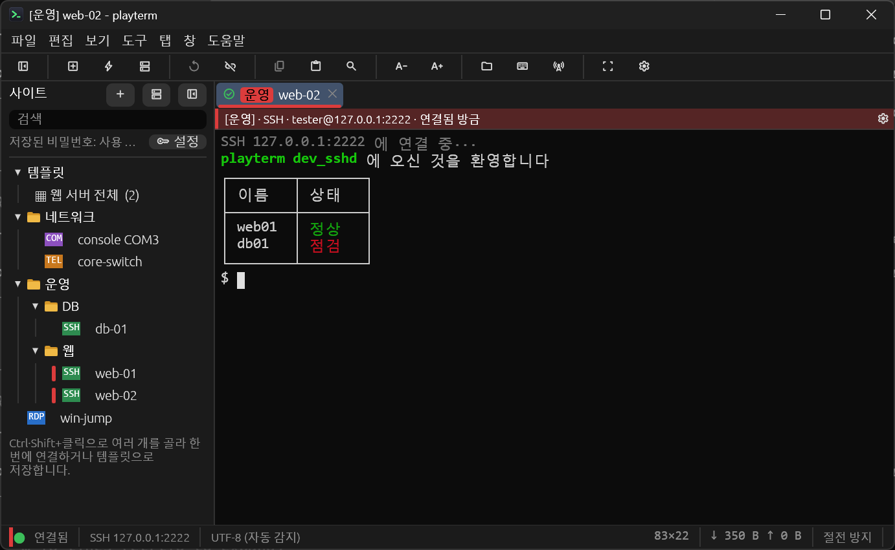
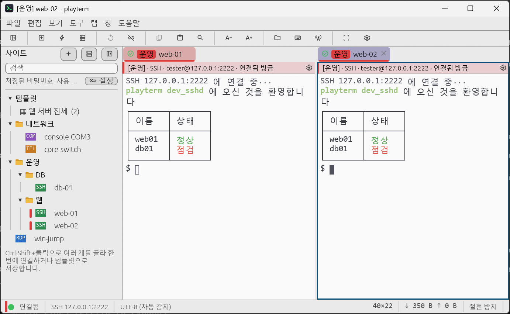
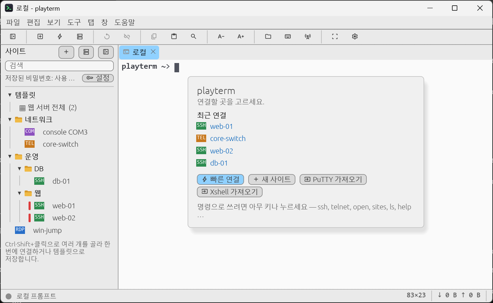

# playterm

[한국어](README.md) | [English](README.en.md) | [日本語](README.ja.md) | [简体中文](README.zh-CN.md) | [Español](README.es.md) | **Português (Brasil)** | [Deutsch](README.de.md) | [Français](README.fr.md) | [繁體中文](README.zh-TW.md) | [Русский](README.ru.md)

**SSH, Telnet, consoles seriais e Área de Trabalho Remota do Windows em abas de uma única janela.**

O playterm é um aplicativo de terminal nativo escrito em Rust (egui, alacritty_terminal, russh e IronRDP). No Windows x64 e ARM64, é distribuído como um executável portátil, sem instalação de runtime. Também oferece um aplicativo para macOS em Apple silicon e Intel.

Este guia em português brasileiro descreve a branch de desenvolvimento `master`. Para os recursos já publicados, consulte as [mudanças da v0.8.0](docs/releases/v0.8.0.md) e as [notas de versão](https://github.com/playok/playterm/releases). A [referência detalhada em inglês](README.en.md) apresenta todas as configurações e os procedimentos de desenvolvimento e distribuição.

## Principais recursos

- SSH, Telnet, serial e RDP em abas e painéis divididos.
- Seleção de vários sites com Ctrl/Shift+clique, conexão conjunta e modelos com sites e disposição dos painéis.
- Autenticação SSH com chaves, certificados e agentes externos; hosts de salto, encaminhamento `-L` / `-R` / `-D` e X11.
- Painel SFTP, transferências ZMODEM (`sz` / `rz`), login automático, macros, entrada simultânea e logs de sessão.
- Cofre de senhas criptografado com uma senha mestra (Argon2id + XChaCha20-Poly1305).
- Importação de sessões do PuTTY, Xshell e SecureCRT, pastas e cores de abas.
- Interface em dez idiomas, temas claro e escuro, escolha de fontes, busca no histórico e codificações internacionais.

## Capturas de tela

As imagens mostram a interface em coreano. Você pode selecionar português brasileiro nas configurações.



| Conexões lado a lado a partir de um modelo | Tela inicial de uma aba desconectada |
| --- | --- |
|  |  |

## Download e execução

Baixe o pacote adequado ao sistema operacional e à CPU em [GitHub Releases](https://github.com/playok/playterm/releases).

- **Windows:** extraia o ZIP e execute `playterm.exe`. Não é preciso instalar o redistribuível do VC++. A partir da próxima versão, os pacotes padrão terão executáveis sem compressão, com pacotes UPX opcionais; confira o formato nas notas de cada versão.
- **macOS 11 ou posterior:** abra o DMG e arraste `playterm.app` para Applications; também é possível usar o ZIP. Consulte as notas de versão e o [guia de macOS em inglês](README.en.md#macos-app) para assinatura, notarização e primeira execução.
- A instalação de atualizações pelo aplicativo funciona apenas no Windows. No macOS, o aplicativo abre a página de download.

Selecione **Português (Brasil)** no campo de idioma em Ferramentas → Configurações. A alteração é exibida imediatamente; Cancelar restaura a seleção anterior. O idioma salvo é mantido após reiniciar. O idioma da interface e a codificação da conexão são configurações independentes.

## Conexão

Salve conexões no gerenciador de sites ou use a conexão rápida. No prompt `playterm>` de uma aba desconectada, digite `ssh user@host`, `telnet host`, `serial COM3 115200`, `rdp user@host` ou `help`.

Também é possível conectar pela linha de comando:

```sh
playterm ssh://user@host:22
playterm -i ~/.ssh/id_ed25519 ssh://user@host
playterm -L 8080:db:5432 -D 1080 ssh://user@host
playterm --cp949 telnet://192.168.0.1
playterm serial://COM3:115200
playterm rdp://user@host
```

No prompt local, `sites` lista os sites salvos e `open nome` ou `open número` conecta a um deles. `ls` / `dir`, `cd` e `pwd` operam sobre arquivos locais. O prompt reaparece quando a conexão termina. [Lista de comandos em inglês](README.en.md#local-command-prompt).

## Uso diário

- **Sites e painéis:** arraste uma aba até a borda de outro grupo para dividir a visualização. Excluir uma pasta de sites move seu conteúdo para a pasta superior; não exclui os sites. Senhas do PuTTY, Xshell e SecureCRT não são importadas.
- **Copiar e colar:** Ctrl+Shift+C / Ctrl+Shift+V. Ctrl+C copia quando há seleção; caso contrário, envia `^C`. É possível ativar a cópia ao selecionar e a colagem com o botão direito. A colagem de várias linhas pede confirmação quando o programa remoto não usa bracketed paste.
- **Busca e exibição:** Ctrl+Shift+F pesquisa também no histórico. Ctrl+roda e Ctrl+= / Ctrl+- / Ctrl+0 ajustam a fonte. Os menus exibem os atalhos correspondentes ao sistema operacional.
- **Entrada simultânea:** Ctrl+Shift+I faz com que teclas e texto colado também sejam enviados às outras abas destinatárias. Confira as marcações laranja; exclua uma aba pelo menu de contexto.
- **Barra de comandos e macros:** Ctrl+Shift+M exibe a barra; Enter envia e Shift+Enter insere uma linha. Macros aceitam `@wait`, `@sleep`, `@if` e outras instruções. Use `{password}` em vez de escrever uma senha.
- **Login automático e manutenção da conexão:** configure etapas “aguardar prompt → enviar texto”, com `{user}` e `{password}`. Escolha mensagens do protocolo SSH/Telnet ou envio de texto para evitar o tempo limite de entrada do equipamento.
- **Codificação:** a detecção automática distingue apenas UTF-8 e CP949. Selecione explicitamente Shift_JIS, EUC-JP, GBK, Big5, páginas de código do Windows ou outras codificações. Consulte a [estrutura de traduções e codificações](docs/i18n.md).

## Transferências e RDP

O painel SFTP ao lado do terminal SSH permite baixar, enviar, criar pastas, renomear e excluir. Em equipamentos sem SFTP, execute `sz file` no servidor para baixar ou `rz` para enviar (o servidor precisa de lrzsz). ZMODEM funciona com SSH, Telnet e serial; Ctrl+C cancela.

RDP exibe a área de trabalho remota em uma aba, com resolução adaptável, áudio e entrada Unicode. O compartilhamento de área de transferência, pastas e impressoras está disponível **somente no Windows**. Há suporte a RD Gateway; microfone e Kerberos ainda não são suportados. Verifique a impressão digital do certificado na primeira conexão: uma alteração posterior bloqueia a conexão. [Detalhes de RDP em inglês](README.en.md#remote-desktop-rdp).

## Autenticação e arquivos de configuração

Verifique a impressão digital da chave do host SSH na primeira conexão. Uma chave salva que mudou impede a conexão. Ative o encaminhamento do agente SSH (`-A`) e o X11 confiável (`-Y`) somente para servidores confiáveis. A assinatura local com chaves privadas RSA é restrita; consulte a [autenticação em inglês](README.en.md#ssh-authentication-order) e o [registro de mitigação RSA](docs/security-rsa-223.md).

No Windows, a configuração fica em `%APPDATA%\playterm\config\`. A variável `PLAYTERM_CONFIG_DIR` permite mudar o diretório para uso portátil ou testes isolados.

| Arquivo | Conteúdo |
| --- | --- |
| `sessions.toml` | Sites e modelos, sem senhas |
| `settings.toml` | Idioma, aparência, teclas, macros e atualizações |
| `vault.toml` | Senhas salvas, criptografadas com a senha mestra |
| `known_hosts` | Chaves de hosts SSH confiáveis |
| `known_rdp_hosts` | Impressões digitais de certificados RDP confiáveis |

Se esquecer a senha mestra, não será possível recuperar as senhas salvas. Macros são armazenadas em texto sem criptografia: não escreva segredos diretamente nelas.

## Compilação e desenvolvimento

É necessário **Rust 1.95 ou posterior**. No Windows, instale as ferramentas MSVC do Visual Studio 2022; ARM64 também requer LLVM/clang. No macOS, são necessárias as Xcode command line tools. As dependências do Linux estão no [guia de contribuição](CONTRIBUTING.md).

```sh
cargo build --release --locked
cargo fmt --all -- --check
cargo clippy --locked --workspace --all-targets -- -D warnings
cargo test --locked --workspace
```

O Windows oferece `build.cmd` e `release.cmd`; no macOS, use `scripts/package-macos.sh` para criar pacotes. [Compilação e assinatura em inglês](README.en.md#building).

- [Compatibilidade](docs/compatibility.md) · [Resultados de validação](docs/validation.md) · [Testes de carga](docs/stress-testing.md)
- [Processo de publicação](docs/release-process.md) · [Mudanças por versão](docs/releases/)
- [Adicionar traduções](docs/i18n.md) · [Contribuir](CONTRIBUTING.md)
- [Relatar uma vulnerabilidade em particular](SECURITY.md)

Esses documentos de referência estão principalmente em inglês ou coreano.

## Licença

[MIT](LICENSE). O subconjunto de Material Symbols Rounded usado nos ícones dos botões está sob a [Apache License 2.0](assets/icons/LICENSE.txt). As licenças das dependências aparecem em Ajuda → Licenças de código aberto.
